<p align="center">
  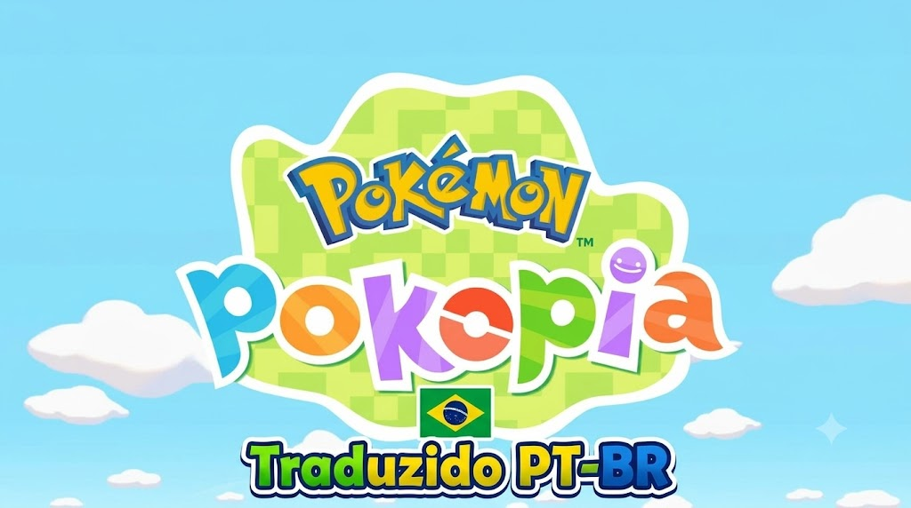
</p>

<h1 align="center">✨🎮 Pokémon Pokopia — Tradução Português do Brasil (PT-BR) 🇧🇷✨</h1>

<p align="center">
  <b>A primeira e mais completa tradução em Português Brasileiro para Pokémon Pokopia do Nintendo Switch 2!</b><br>
  Criado com carinho, engenharia reversa avançada e dedicação para toda a comunidade Pokémon do Brasil! 🇧🇷❤️
</p>

<p align="center">
  
  
  
  
</p>

---

> [!IMPORTANT]
> ### ⚠️ COMPATIBILIDADE OBRIGATÓRIA / ATENÇÃO:
> **Esta tradução (Versão 2.0) funciona exclusivamente na versão 2.0.1 do jogo Pokémon Pokopia.**  
> Certifique-se de que o seu jogo esteja atualizado com o **Update v2.0.1** (Title ID: `0400A3A01EE4C000`) antes de aplicar a modificação. O funcionamento e a compatibilidade não são garantidos em versões anteriores da ROM.

---

### ⭐ Apoie o Projeto! Deixe sua Estrelinha no GitHub! ⭐

> 🌟 **Gostou do projeto e quer ver mais atualizações incríveis?**  
> Não se esqueça de clicar na **estrelinha (Star ⭐)** no topo superior direito da página do repositório no GitHub! Isso ajuda demais a divulgar o projeto para a comunidade e motiva a trazer mais melhorias contínuas! 🚀✨

---

## 📜 Sobre o Projeto

Este projeto tem como objetivo trazer **Pokémon Pokopia** totalmente para o nosso idioma materno, o **Português do Brasil (PT-BR)**! 🇧🇷🎉

Através de um trabalho minucioso de **Engenharia Reversa** na arquitetura da ROM do Nintendo Switch 2 (Koei Tecmo KIDS / Katana Engine), foi possível decodificar os arquivos internos do contêiner `LD_C0_R.BIN` e `LI_C0_R.IDX`, recalcular tabelas de ponteiros relativos em memória com precisão matemática milimétrica e reconstruir os pacotes de compressão `zlib` em blocos alinhados de 64KB, além de todas as texturas e interfaces em alta definição no formato nativo da GPU Tegra X1.

### 🌟 Destaques da Versão 2.0 (Revisão Textual Completa):
* ✍️ **Revisão Textual Geral 2.0:** Passagem minuciosa por diálogos, descrições, itens e menus para aprimorar a naturalidade, coesão, gramática e fluidez das falas.
* 🇧🇷 **Menu de Seleção de Idioma:** A opção *English* foi substituída por **Português (Brasil)** logo na primeira tela do jogo!
* 🗣️ **Diálogos Naturais e Cenas de Corte:** Diálogos completos, incluindo a introdução de despertar do Ditto, personalização do Treinador, cutscenes com o Professor Tangrowth e tutoriais.
* 💬 **Balões de Fala e Expressões:** Balões amarelos de pensamento dos Pokémon (como o clássico pedido de água *"Á... água..."* do Squirtle no início do jogo) traduzidos!
* 🐾 **Nomes de Pokémon 100% Originais:** Todas as mais de 370 espécies de Pokémon citadas no jogo tiveram seus nomes originais preservados (Pikachu, Squirtle, Ditto, Scyther, Haunter, Tangrowth, etc.), mantendo a fidelidade oficial da franquia!
* 🛠️ **Compatibilidade Total LayeredFS:** Pronto para rodar tanto em **Emuladores** quanto no **Console Real Nintendo Switch 2 com CFW (Atmosphère)**!

---

## ⚠️ AVISO LEGAL E DE DIREITOS AUTORAIS (DISCLAIMER)

> 🚨 **IMPORTANTE / LEIA COM ATENÇÃO:**  
> * **Pokémon**, **Pokémon Pokopia**, personagens, marcas e nomes relacionados são propriedades registradas de **Nintendo**, **Creatures Inc.** e **GAME FREAK inc.** / **The Pokémon Company**.
> * Este é um projeto de fã, sem fins lucrativos, feito exclusivamente para fins de acessibilidade, estudo e preservação cultural da comunidade brasileira.
> * **É ESTRITAMENTE NECESSÁRIO POSSUIR UMA CÓPIA ORIGINAL E LEGÍTIMA DO JOGO** para utilizar este patch de tradução. 
> * Nenhum arquivo proprietário original protegido por direitos autorais (ROM completa, chaves ou executáveis) é distribuído aqui.

---

## 🚀 PROJETO EM CONSTANTE EVOLUÇÃO & REPORTE DE BUGS!

> 💡 **Este é um projeto vivo e em contínua evolução!** 🛠️  
> 
> Como o jogo possui dezenas de milhares de linhas de texto, diálogos dinâmicos e variáveis de contexto, é possível que surja algum texto que precise de ajuste ou algum balão fora de formatação.
>
> 🐛 **Encontrou algum erro, frase estranha ou bug visual?**  
> Por favor, **[ABRA UMA ISSUE AQUI NO REPOSITÓRIO GITHUB](../../issues)**!  
> Tire um print da tela com o texto e descreva onde ele aparece no jogo. Todas as correções são analisadas e incorporadas nas próximas builds! 📝🔍

---

## 📸 Galeria de Imagens do Jogo (Screenshots)

Confira abaixo alguns registros da tradução rodando diretamente no jogo:

<div align="center">

| Tela de Apresentação | Menu e Diálogos |
| :---: | :---: |
| 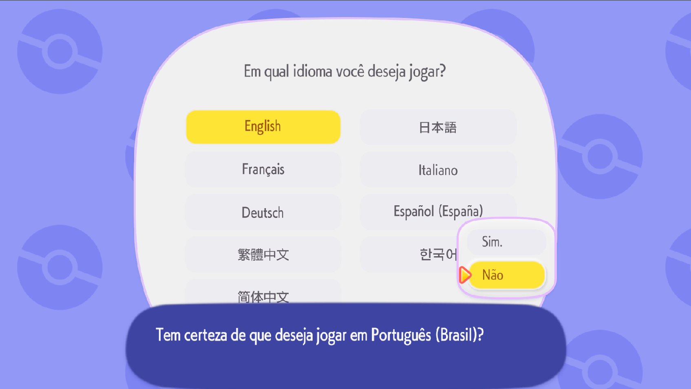 | 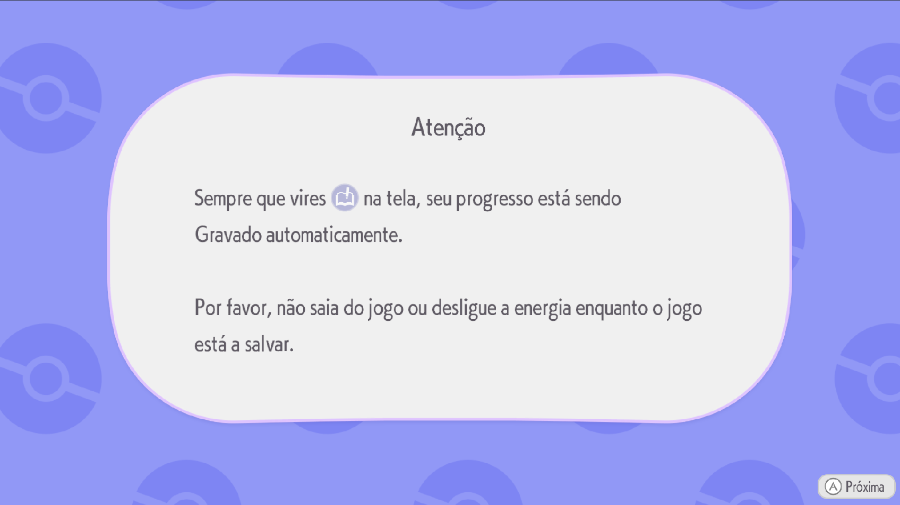 |

| Exploração e Ambientes | Interações e Personagens |
| :---: | :---: |
| 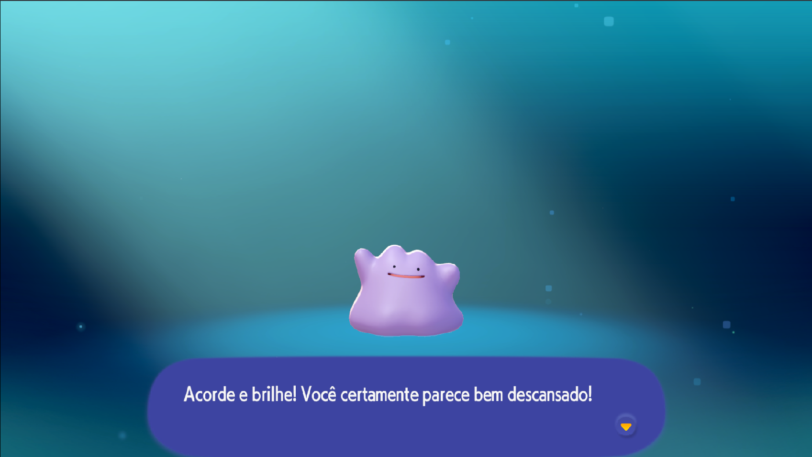 | 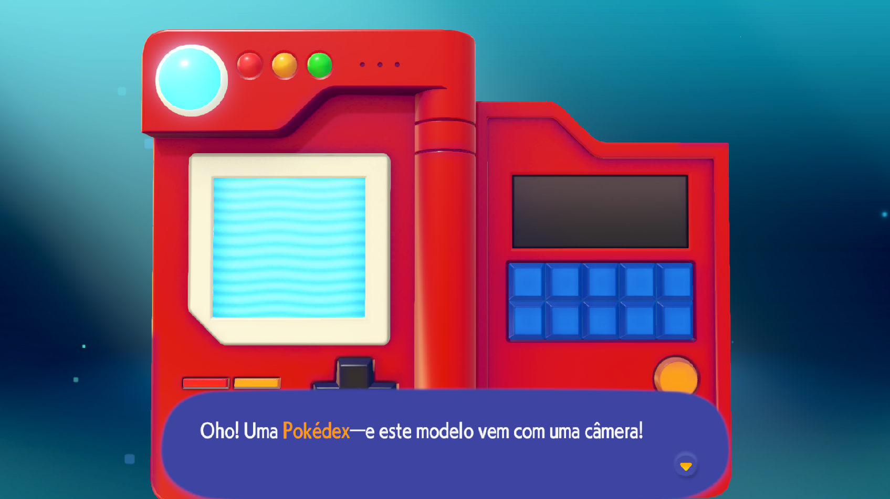 |

| Conversas e Detalhes | Cenas e Animações |
| :---: | :---: |
| 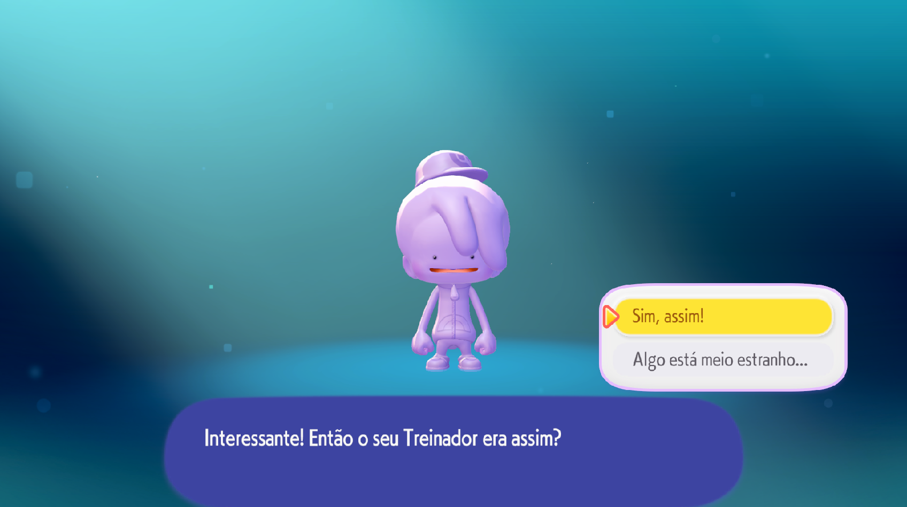 | 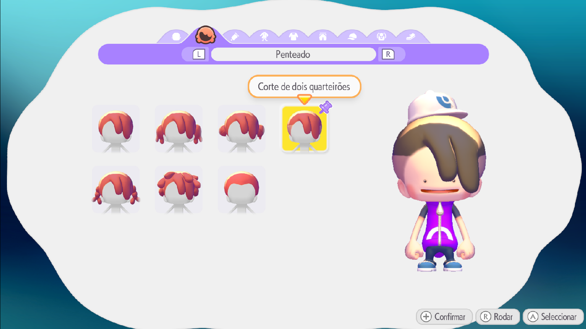 |

| Tutoriais e Avisos | Pokédex e Missões |
| :---: | :---: |
| 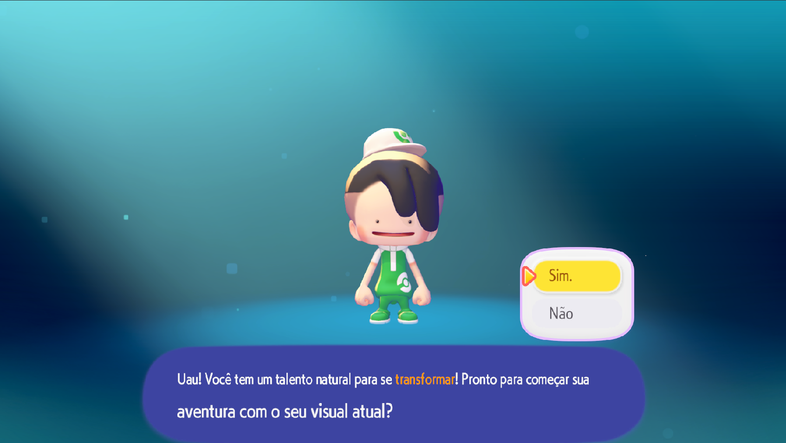 | 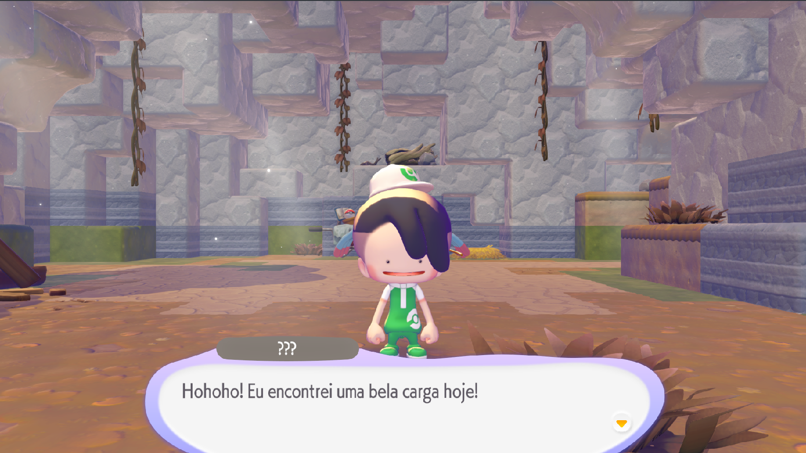 |

| Balões de Fala e Pedidos | Momentos In-Game |
| :---: | :---: |
| 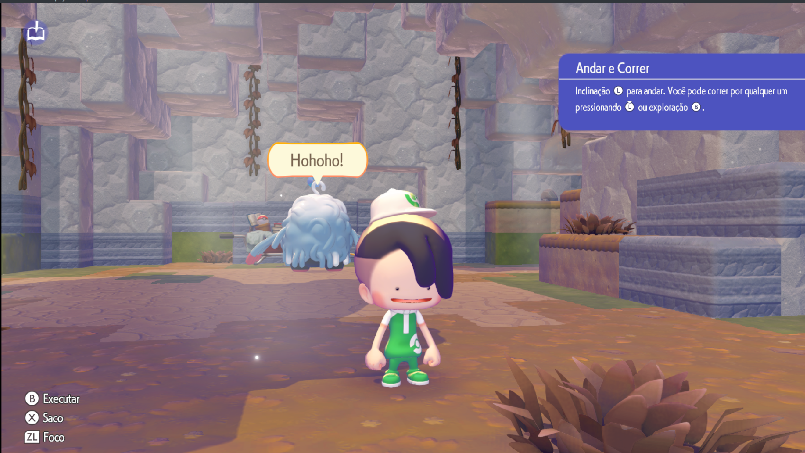 | 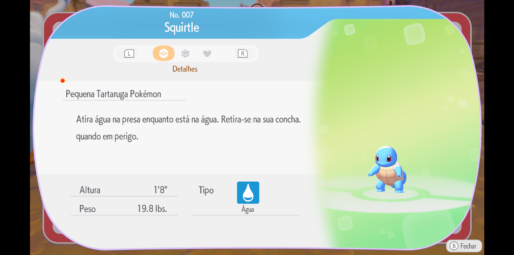 |

| Registros de Aventura |
| :---: |
| 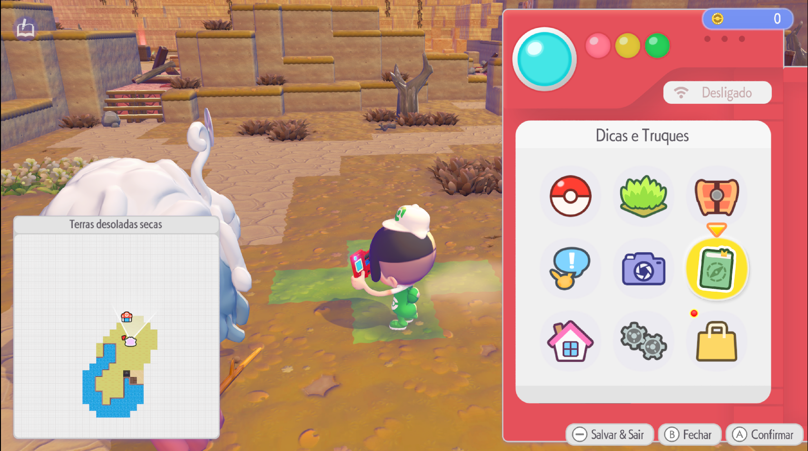 |

</div>

---

## 📦 Como Instalar a Tradução

As versões já vêm 100% montadas e prontas para uso na pasta [`builds/`](builds/) ou diretamente na raiz do pacote!

### 🕹️ Opção 1: Console Real Nintendo Switch 2 (Atmosphère CFW)
1. Baixe o pacote **`Pokopia_PTBR_v2.0.0_Switch2.zip`** (ou use a pasta `atmosphere/` já inclusa).
2. Conecte o cartão microSD do seu console no computador.
3. Extraia ou copie a pasta `atmosphere` diretamente para a **raiz do seu cartão microSD** (`sdmc:/`).
   * A estrutura no seu cartão ficará exatamente assim:  
     ```plaintext
     sdmc:/
     └── atmosphere/
         └── contents/
             └── 0400A3A01EE4C000/
                 └── romfs/
                     ├── LD_C0_R.BIN
                     ├── LI_C0_R.IDX
                     └── motor_asset_re/
                         └── KIDS_PLATFORM_OUNCE/
                             ├── 0x4b13d561.fdata
                             └── root.rdb
     ```
4. Insira o microSD de volta no Nintendo Switch 2, inicie o jogo atualizado na versão **2.0.1** e aproveite! 🚀✨

---

### 💻 Opção 2: Emuladores (Ryujinx, Eden, Eglantine, etc.)
1. Baixe o arquivo **`Pokopia_PTBR_v2.0.0_Emulador.zip`**.
2. Abra o seu emulador:
   * **No Ryujinx:** Clique com o botão direito sobre *Pokémon Pokopia* na lista de jogos -> selecione **Open Mods Directory** e extraia o conteúdo (`Traducao_PTBR/`) dentro da pasta do Title ID `0400A3A01EE4C000`.
   * **No Eden / Eglantine:** Acesse a pasta `%APPDATA%\eden\load\0400A3A01EE4C000\` (ou o diretório de mods correspondente) e extraia a pasta lá.
3. Inicie o jogo atualizado na versão **2.0.1**, selecione **Português (Brasil)** na tela inicial de idiomas e boa diversão! 🎮🎉

---

## 🗂️ Estrutura deste Pacote

```plaintext
Tradução 2.0/
├── README.md                              # 📖 Documentação completa do projeto
├── imgs/                                  # 🖼️ Banner oficial e capturas de tela do jogo
│   ├── banner_pokopiabr.jpg               # 🌟 Banner principal de cabeçalho
│   └── 1.png até 11.png                  # 📸 Imagens demonstrativas da tradução
├── atmosphere/                            # 🕹️ Estrutura pronta para Atmosphère (Switch 2)
│   └── contents/
│       └── 0400A3A01EE4C000/
│           └── romfs/                     # 📂 Arquivos de dados e texturas traduzidas
├── builds/                                # 📦 Builds compactadas para distribuição (.zip)
│   ├── Pokopia_PTBR_v2.0.0_Switch2.zip   # 🕹️ Pacote pronto para Atmosphère (Switch 2)
│   └── Pokopia_PTBR_v2.0.0_Emulador.zip  # 💻 Pacote pronto para Emuladores
├── Pokopia_PTBR_v2.0.0_Switch2.zip        # 🕹️ Cópia direta do pacote para Switch 2
└── Pokopia_PTBR_v2.0.0_Emulador.zip       # 💻 Cópia direta do pacote para Emuladores
```

---

## 👨‍💻 Autor e Créditos

* **Idealização, Engenharia Reversa e Tradução:** **Marcos Dias** 👑
* **Ferramental & Automação:** Python, REA Engine Tools & CTranslate2 Neural Processing ⚡
* **Agradecimentos Especiais:** A toda a comunidade Pokémon e de fãs de traduções brasileiras que mantêm a paixão pelos games viva! 💖

---

<p align="center">
  <b>Feito com dedicação para todos os jogadores do Brasil! 🇧🇷🎮✨</b><br>
  <i>Se este projeto foi útil para você, considere deixar uma ⭐ no repositório!</i>
</p>